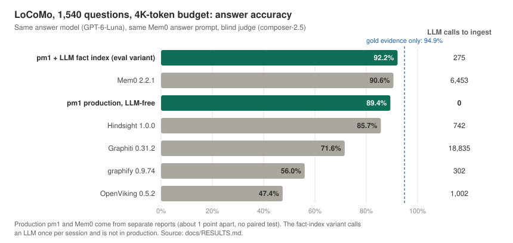

# Agent Memory (pm1)

pm1 is a local memory for AI coding agents. It records every Claude Code, Codex and Cursor session without calling an
LLM, and over MCP it returns the original records that answer a question, packed to a fixed token budget.

## Problem

Coding agents forget everything between sessions. Each new chat asks again what was decided, which fix failed, which
command ran and what the user approved. Most memory add-ons fix this by having an LLM summarize every conversation
into "facts" when they write it. That costs many LLM calls per session. The summaries can be wrong, and the agent then
reads the summary instead of what was actually said.

pm1 does the opposite:

- **No LLM at write time.** It stores raw turns (secrets redacted) and builds the indexes from them.
- **Precise retrieval at read time.** It searches by keyword and by meaning, then reranks with a small cross-encoder.
- **Evidence, not summaries.** Every result is an original record with an `episode_id` that the agent can open in
  context.

The question pm1 was built to answer: how close can an LLM-free memory get to LLM-extracted memories on public
benchmarks, and at what cost?

## Architecture

```text
 Claude Code / Codex / Cursor transcripts, Cowork exports, document folders
        │  pm1-capture (read-only)                   ── no LLM calls at write time ──
        ▼
 redact secrets → split into spans (≤1,200 chars) → SQLite (raw records are the only evidence)
        │                         │                          │
        ▼                         ▼                          ▼
 FTS5 BM25 index           dense vectors              session structure
 (Porter stemming,         multilingual-e5-small      (records grouped by session and project;
  jieba for Chinese)       384-d, CPU or GPU          session_brief built from records, no LLM)
        └──────────── first stage: reciprocal-rank fusion, optional zh↔en query translation ───┘
                                          │
                                          ▼
                   cross-encoder rerank (Qwen3-Reranker-0.6B, up to 100 candidates;
                   language-aware router; falls back to the fused order if unavailable)
                                          │
                                          ▼
                   token-budget packing (default 4K: one header per session, in time order,
                   plus the next turn of each hit)
                                          │
                                          ▼
          MCP server (stdio): search_sessions · open_record · session_brief · code_history ·
                              search_docs · cite · rules / propose_rule · save_note · pm1_feedback
```

The main pieces in `src/pm1/`:

| Module | Role |
|---|---|
| `capture.py`, `cc_hook.py` | read agent transcripts; Claude Code hooks |
| `redact.py` | strip API keys, tokens and passwords before storage and again on every MCP result |
| `store.py`, `text.py`, `lang.py` | SQLite store, spans, FTS5 index, tokenization (English and Chinese) |
| `embed.py`, `worker.py`, `sessindex.py` | dense vectors (local fastembed, or an HTTP llama.cpp service), background backfill, shared memory-mapped index |
| `sessions.py` | `search_sessions`: BM25 + dense fusion, rerank, session layout, token packing |
| `rerank.py` | reranker routing by language and latency budget (vLLM / llama.cpp / fastembed backends) |
| `recall.py` | the note-recall path used in the LoCoMo experiments (`memory_recall`, now `search_notes`) |
| `mcp.py` | the stdio MCP server |
| `codemap.py`, `codectx.py` | `code_history`: which session edited a file, why, and what failed next (optionally with graphify call graphs) |
| `docs.py`, `docparse.py` | document folders (Markdown, PDF, DOCX, XLSX) with citable evidence IDs |
| `rules.py` | standing rules and lessons: agents may propose them, only the user can approve them |

[`docs/DESIGN.md`](docs/DESIGN.md) explains the design (with a [diagram](docs/img/architecture.svg)), and
[`docs/REFERENCE.md`](docs/REFERENCE.md) covers every tool, setting and privacy property in detail.

## Install and quickstart

Requirements: Linux, and Python 3.10 or newer whose `sqlite3` has FTS5 (most builds do). No GPU is needed.

```sh
git clone <repo-url> precision-memory && cd precision-memory
python3 -m venv .venv
.venv/bin/pip install -e '.[local-embed,docs]'   # local-embed = CPU e5 vectors; docs = PDF/DOCX/XLSX parsers

export PM1_DB=~/.local/state/pm1/memory.sqlite    # this is also the default
.venv/bin/pm1-capture scan                        # import existing Codex / Claude Code / Cursor sessions
.venv/bin/pm1-worker --exit-when-empty            # compute vectors (BM25 works without them)
.venv/bin/pm1-capture watch -i 60                 # keep capturing (or: deploy/install.sh --with-capture)
```

`deploy/install.sh [--prefix DIR] [--db FILE] [--with-capture] [--dry-run]` does the same for one user. It creates the
virtualenv and the command wrappers, and it can add a systemd user unit for capture. It prints the MCP registration
snippets but does not edit your agent configuration.

Optional speed and quality tiers (see `docs/THIRD_PARTY.md` for the models):

- **CPU only (default):** BM25 + local e5 vectors. Nothing to set up beyond `pip install`.
- **With a reranker:** serve Qwen3-Reranker-0.6B (`deploy/pm1-rerank-vllm.sh` for vLLM on a GPU, or
  `scripts/reranker.sh` for llama.cpp), then set `PM1_RERANK_QWEN_VLLM=http://127.0.0.1:<port>` or
  `PM1_RERANK_QWEN=...`.

## Connecting Claude Code, Codex and Cursor (MCP)

Every client starts `pm1-mcp` over stdio. Use one small wrapper so all three registrations match:

```sh
#!/bin/sh
export PM1_DENSE=local PM1_THREADS=4
export PM1_RERANK_PROFILE=wait PM1_QUALITY_FLOOR=wait   # wait up to 8 s for a reranker, if one is configured
exec /path/to/precision-memory/.venv/bin/pm1-mcp "$@"
```

**Claude Code** (`claude mcp add`, or `mcpServers` in `~/.claude.json`):

```json
"pm1": { "command": "/path/to/pm1-mcp-wrapper", "args": [], "env": { "PM1_CLIENT": "claude-code" } }
```

**Codex** (`~/.codex/config.toml`):

```toml
[mcp_servers.pm1]
command = "/path/to/pm1-mcp-wrapper"
args = []

[mcp_servers.pm1.env]
PM1_CLIENT = "codex"
```

**Cursor** (`mcpServers` in `~/.cursor/mcp.json`):

```json
"pm1": { "command": "/path/to/pm1-mcp-wrapper", "args": [], "env": { "PM1_CLIENT": "cursor" } }
```

The agent can then call `search_sessions("what did we decide about the reranker timeout")`, and `open_record` on any
`episode_id` it gets back. Results come wrapped in a notice that they are records, not instructions.

## Results

Full tables are in [`docs/RESULTS.md`](docs/RESULTS.md); the method, every experiment (including the ones that
failed) and the intervals are in [`docs/EVALUATION.md`](docs/EVALUATION.md). Two retrieval paths appear:

- **[prod]** `search_sessions`, the production tool agents call;
- **[eval]** `memory_recall`, the path most LoCoMo experiments used, with options production does not have (such as
  the LLM fact index).



### LoCoMo (1,540 questions, 4K-token budget)

Every system's context is answered by GPT-6-Luna with Mem0's official answer prompt and judged blind by composer-2.5.

| System | LLM calls to ingest | Accuracy at 4K |
|---|---|---|
| pm1 + LLM fact index [eval] (evaluation variant only) | 275 (about 1/23 of Mem0) | **92.2%** |
| Mem0 2.2.1 | 6,453 | 90.6% |
| **pm1 production `search_sessions` [prod], LLM-free** | **0** | **89.4%** |
| Hindsight 1.0.0 | 742 | 85.7% |
| Graphiti 0.31.2 | 18,835 | 71.6% |
| Upper bound: gold evidence only | — | 94.9% |

- **LLM-free pm1 is about 1 point below Mem0** (89.4% vs. 90.6%). The two numbers come from separate reports judged
  in different batches, so there is no paired test of this gap. At a 1K budget the gap is about 2.8 points.
- **The fact-index variant** calls an LLM once per session (275 calls, about 1/23 of Mem0's) and reaches 92.2%. It is
  an evaluation variant and is **not in production**.
- **The reranker matters.** On the production path (judged separately by GPT-6.1-Sol), reranking all 100 candidates
  adds +9.8 points [+8.0, +11.7] at 1K and +3.8 [+2.5, +5.2] at 4K over no reranking.

### Retrieval benchmarks

| Benchmark | Metric | pm1 | Comparison |
|---|---|---|---|
| **LongMemEval-S**, 470 questions | all gold sessions in the top 5 | **92.3%** | agentmemory BM25 84.7%: **+7.7 points [+5.1, +10.4]** |
| same, CPU only, no reranker (94-question sample) | same | 92.6% | production retrieval 93.6% on the same sample |
| **Coding trajectories**, 40 SWE-agent sessions, 85 paraphrased questions | hit@1 | **97.6%** | claude-mem 85.9% (+11.8 [+5.9, +18.8]); agentmemory BM25 84.7% |

pm1's lead comes from vectors and reranking; its keyword search alone ties BM25.

### Where pm1 is weaker

- **Long conversations (BEAM-1M).** With BEAM's official answer prompt, production pm1 scores 0.535 against Mem0's
  0.645, about 11 points behind (+11.0 [+7.0, +14.9] for Mem0). Most of that is the answer step: with the same
  retrieved context, Mem0's answering rules move pm1 to 0.639, and adding an event-row view written by a local 27B
  model (not in production) reaches 0.662, a lead of +1.8 [−1.9, +5.5] that is not statistically shown.
- **Latency.** A production `search_sessions` call has a p50 of about 3.7 s (p95 7.0 s), almost all of it the
  reranker. Mem0 retrieves in 0.13 s. The CPU path without a reranker answers in milliseconds.
- **Error analysis.** Once the budget is used well, the answer step, not retrieval, is the bottleneck: adding more
  evidence (graph hops, bigger budgets, sub-queries) raised evidence coverage without raising accuracy, while
  changing only the answer prompt moved BEAM scores by about 9 points.

## Evaluation method

- **Same conditions.** Every system gets the same answer model, answer prompt, token budget and judge. Systems that
  call an LLM to write memories all use the same model through one proxy, so their write costs are counted alike.
- **Blind judge.** Answers are shuffled, given neutral ids and judged without the system name. Scores from different
  judges are never subtracted from each other.
- **Paired bootstrap.** 10,000 resamples (seed 2026); a difference counts only if its 95% interval excludes 0.
- **Pre-registration.** Each experiment's arms, data split, metric and decision rule were fixed before any answer was
  generated; later changes were logged as amendments and labeled exploratory.
- **Dev/test discipline.** Tuning used dev splits only. The BEAM-1M test split is still sealed.
- **Public data only.** LoCoMo, LongMemEval-S, BEAM, REALTALK, LifeGen, PerLTQA and SWE-agent trajectories. The
  datasets used by this repository's code are fetched by `scripts/prepare_data.sh`; their sources and licenses are in
  [`docs/THIRD_PARTY.md`](docs/THIRD_PARTY.md).

The evaluation code is in `eval/`: LongMemEval runners (`lme*.py`, `bakeoff.py`), BEAM runners and the official
judge (`beam_*.py`, `beam_official/`, `mv_arms.py`), the trajectory retrieval run (`traj_pm1.py`), reranker
comparisons (`*rerank*_eval.py`, `colbert_*.py`) and paired-bootstrap reports (`beam_ab_report.py`,
`lme_g5_report.py`). The LoCoMo harness that ran the competitor systems is not included (see Limitations).

## Limitations

- **Cross-session aggregation is the weak spot.** BEAM summarization and multi-session questions, and LoCoMo
  multi-hop questions at 1K, need many scattered facts merged. Retrieving raw turns does less well there than merging
  facts at write time.
- **Production latency.** p50 about 3.7 s per search, almost all reranking.
- **The LLM fact index is not in production.** It adds 2.8 points on LoCoMo but nothing on BEAM (−0.9).
- **Help with writing code is unproven.** A 52-task code benchmark showed no gain, and that benchmark cannot measure
  memory: the tasks are self-contained, 52 tasks are too few, and only hidden tests are scored.
- **LoCoMo is near its ceiling.** The best result is 0.929 against a gold-evidence bound of 0.949.
- **Not packaged yet.** Version `0.1.0.dev0`, tested on one Linux machine. The int8 ONNX embedder targets
  AVX512-VNNI and has not been checked on other CPUs.
- **Not fully reproducible from this repository.** The competitor harness, the derived prompt files and the raw run
  outputs are not published; [`docs/EVALUATION.md`](docs/EVALUATION.md) records the configurations used.

## Repository layout

```text
src/pm1/       library, MCP server, capture, worker, CLIs
tests/         unit tests (pytest; no GPU, network or private data needed)
eval/          benchmark runners, judging, bootstrap reports; eval/beam_official/ is vendored MIT code
scripts/       CI gate, data download, model fetch, llama.cpp / e5 helpers
deploy/        installer, smoke test, example systemd unit, vLLM reranker launcher
docs/          DESIGN.md (architecture), EVALUATION.md (method and every experiment), RESULTS.md (headline
               tables), REFERENCE.md (full manual), THIRD_PARTY.md (models, datasets, licenses), img/ (figures)
```

Run the tests with `pip install -e '.[dev]'` and then `python -m pytest -q tests`. `scripts/ci.sh` also runs the
benchmark-vocabulary leak check.

## License

Apache License 2.0; see `LICENSE` and `NOTICE`. The vendored BEAM files in `eval/beam_official/` keep their MIT
license. Models and datasets are not included and keep their own licenses (`docs/THIRD_PARTY.md`).

---

Built with AI coding agents; system design, evaluation rules and review by Gary Xiao.
