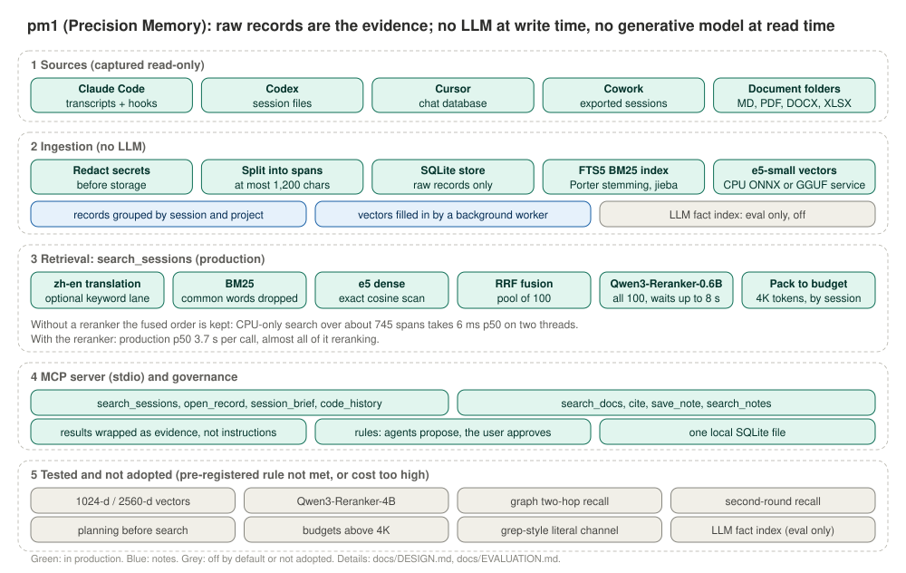

# pm1 design

This document describes how Precision Memory (pm1) stores and retrieves agent sessions. The full list of tools and
settings is in [REFERENCE.md](REFERENCE.md); how the design was tested is in [EVALUATION.md](EVALUATION.md).



## Goals

1. **No LLM at write time.** Every session an agent has ever run can be imported, at the cost of tokenizing and
   embedding it. Nothing is summarized, so nothing is lost or rewritten on the way in.
2. **Evidence, not summaries.** A search returns original records (turns, tool results, document blocks), each with an
   `episode_id` or `evidence_id` that the agent can open or cite.
3. **Precise at read time.** Because the index holds raw text, the work happens at query time: two first-stage
   retrievers, a cross-encoder reranker and a packer that fits the best evidence into a fixed token budget.
4. **Local.** One SQLite file, one stdio MCP server, optional local model services. Secrets are redacted before
   storage.

The trade-off is deliberate. Systems such as Mem0 or Graphiti call an LLM for every turn or session to extract facts.
That helps questions that need many scattered facts merged together, and it costs thousands of LLM calls per corpus.
pm1 keeps the raw record and asks how far retrieval alone can go. [EVALUATION.md](EVALUATION.md) measures both sides
of that trade-off.

## Ingestion (no LLM)

```text
transcripts ──► capture ──► redact ──► split into spans ──► SQLite (records + spans)
                                                              ├─► FTS5 keyword index (immediate)
                                                              └─► e5 vectors (background worker)
```

**Sources.** `pm1-capture` reads agent transcripts read-only:

| Source | What is read |
|---|---|
| Claude Code | `~/.claude/projects/*/*.jsonl`, plus optional hooks (`pm1.cc_hook`) that capture turns live |
| Codex | `~/.codex/sessions/*/*/*/rollout-*.jsonl` |
| Cursor | `state.vscdb` opened read-only, `workspace.json` to map chats to folders |
| Cowork | explicit export import (`pm1-capture import-conversation`) |
| Document folders | Markdown, PDF, DOCX, XLSX through `pm1-docs` (citable `evidence_id`s) |

Each turn becomes a record with its time, role, client, session and project scope (`proj:<working folder>`). During
capture pm1 also extracts code history: which files a session touched, commands that failed, commits.

**Redaction.** API keys, tokens, bearer headers and `password=`-style values are cut before a record is stored, and
again from every MCP result (`redact.py`). The patterns are simple and can miss unusual formats.

**Spans.** Long records are split into spans of at most 1,200 characters (`text.py`, `MAX_SPAN_CHARS`). Spans are the
unit of retrieval; results are shown per record.

**Keyword index.** SQLite FTS5 with BM25 scoring. English text is Porter-stemmed; Chinese text is segmented with
jieba. A record is searchable by keyword as soon as it is captured.

**Vectors.** `intfloat/multilingual-e5-small` (384 dimensions) embeds every span. Two back ends produce the same
model:

- `PM1_DENSE=local`: fastembed with the int8 ONNX file, on the CPU, no service needed;
- `PM1_DENSE=http` or `split`: a llama.cpp server with the q8 GGUF file, on CPU or GPU.

`pm1-worker` fills in vectors in the background and can be rate-limited or run only at night. The session vector
index is memory-mapped and searched by an exact scan; the vector lanes of one query share a single scan.

**What is not built at write time.** No facts, no entity graph, no summaries in the default configuration. A fact
index (one LLM call per session) and a fact graph exist in the code for experiments (`facts.py`, `PM1_FACTS`). They
are off by default and are not part of production (see [EVALUATION.md, LoCoMo v3](EVALUATION.md#e3-fact-index-pm1-v3)).

## Retrieval: `search_sessions`

`search_sessions` is the tool agents call. One call runs this pipeline (`sessions.py`):

```text
query ─┬─► BM25 (FTS5) ───────────────┐
       ├─► BM25 on the zh↔en translation (optional lane)
       └─► e5 dense (exact scan) ─────┴─► reciprocal-rank fusion ─► pool of 100
                                                                        │
             project filter / current-folder boost ◄────────────────────┘
                                │
                                ▼
       cross-encoder rerank of all 100 (Qwen3-Reranker-0.6B, latency budget)
                                │
                                ▼
       neighbours and next turns ─► pack to the token budget, grouped by session ─► MCP result
```

1. **First stage.** BM25 and e5 each return their best spans; reciprocal-rank fusion merges them into a pool of 100
   candidates (`PM1_SESS_POOL`). With `PM1_SESS_DF_MAX=0.05`, words found in more than 5% of spans are left out of the
   BM25 OR-query (the three rarest words always stay), which keeps common words such as "run" or "model" from making
   FTS5 score tens of thousands of rows. With `PM1_SESS_XLATE` set, the query's translation (Chinese to English or the
   reverse) runs as its own keyword lane, because agents often search Chinese records in English.
2. **Scope.** A named `project` is a hard filter. Without one, records from the client's current folder and project
   move up a few places.
3. **Rerank.** All 100 candidates are scored by Qwen3-Reranker-0.6B, served by vLLM on a GPU or by llama.cpp. A router
   picks the reranker by language and by the call's latency profile (`fast` 250 ms, `balanced` 1 s, `wait` 8 s,
   `best` unbounded). English-only rerankers never see non-English text. If no reranker answers in time, the fused
   order is kept and the result says so; a failed reranker cools down for 60 s.
4. **Context.** The top three hits bring the turns next to them in the same session (`PM1_SESS_NEIGHBORS=3,1`). With
   `PM1_SESS_NEXT_TURN=20`, the first 20 hits can also bring the turn that followed them, often the answer to a
   question; `PM1_SESS_NEXT_LEFTOVER=1` adds those only from budget left after every hit is placed.
5. **Packing.** Hits are added in reranked order until the budget is used (default 4,000 tokens, `k` = 8 hits by
   default, at most 20). Long records are cut around the matching sentences. Each record is charged 50 extra tokens
   for its fields (date, project, ids). With `PM1_SESS_LAYOUT=session`, the result is grouped under one header per
   session, in time order.
6. **Result.** The response carries the records, their `episode_id`s, the route taken (`mode`, fallbacks) and a
   `call_id`. It is wrapped in a notice that the content is evidence to reason over, not instructions. Every call is
   logged locally in `mcp_calls`.

### The evaluation path: `memory_recall` / `search_notes`

`recall.py` holds a second retriever, `memory_recall` (now exposed as `search_notes` for notes agents save on
purpose). Most LoCoMo experiments ran on it, so the result tables mark it **[eval]**. It differs from production:
BM25 top 50 + vector top 50, only the first 16 fused candidates reranked (`PM1_RERANK_K=16`), five hits with ±2
neighbour turns (`PM1_NEIGHBORS=5,2`), and the optional fact index. Since 2026-11-15 evaluations use the production
path.

## MCP tools

One stdio server, `pm1-mcp`, serves every client:

| Tool | Purpose |
|---|---|
| `search_sessions` | search past Codex, Claude Code, Cursor and Cowork sessions (filters: project, host, time, roles) |
| `open_record` | one record with the turns around it |
| `session_brief` | hand-off brief of a past session (goal, requests, approvals, open tasks, files, commits), built from records without an LLM |
| `code_history` | which sessions edited a file or symbol, why, and what failed next; call graphs from graphify when present |
| `search_docs`, `cite`, `docs_status` | search registered document folders; `cite` checks that a file has not changed since indexing |
| `rules`, `propose_rule` | standing rules and lessons; agents may propose one by quoting the user, only the user can approve it in a terminal (`pm1-rule`) |
| `save_note`, `search_notes`, `memory_status` | notes an agent saves on purpose |
| `pm1_feedback` | the agent reports whether a result helped (usage meter only) |

## Configuration that matters

Every setting is an environment variable (or a key in `~/.config/pm1/config.toml`); [REFERENCE.md](REFERENCE.md#configuration-reference)
lists them all. The code defaults are conservative. The configuration measured in the evaluation as "production" is:

```sh
export PM1_DENSE=split                      # e5 GGUF services; or PM1_DENSE=local for CPU-only fastembed
export PM1_SESS_FULL=1                      # BM25 + e5 over every project, rerank the fused pool
export PM1_SESS_DF_MAX=0.05                 # drop very common words from the BM25 query
export PM1_SESS_XLATE=http://127.0.0.1:PORT # optional zh<->en query translation lane (pm1.xlate)
export PM1_SESS_LAYOUT=session              # one header per session, in time order
export PM1_SESS_NEXT_TURN=20 PM1_SESS_NEXT_LEFTOVER=1
export PM1_RERANK_QWEN_VLLM=http://127.0.0.1:PORT
export PM1_RERANK_PROFILE=wait PM1_QUALITY_FLOOR=wait   # wait up to 8 s for the reranker
```

| Variable | Code default | Effect |
|---|---|---|
| `PM1_DB` | `~/.local/state/pm1/memory.sqlite` | the one database file |
| `PM1_DENSE` | `local` if fastembed is installed, else `none` | vector back end (`local`, `http`, `split`, `none`) |
| `PM1_THREADS` | 8 | ONNX threads for the local embedder |
| `PM1_SESS_FULL` | 0 | 1 = dense search over all projects with an in-process index (about 340 MB at 220K spans) |
| `PM1_SESS_POOL` | 100 | candidates kept after fusion and sent to the reranker |
| `PM1_SESS_DF_MAX` | 0 (off) | document-frequency cut for BM25 query words |
| `PM1_SESS_NEIGHBORS` | `3,1` | hits that bring neighbours, and how many turns each side |
| `PM1_SESS_LAYOUT` | `items` | `session` groups results by session |
| `PM1_RERANK_*` | unset | reranker service URLs; without one, the fused order is used |
| `PM1_RERANK_PROFILE` | `balanced` | latency budget for the rerank step |
| `PM1_FACTS` | 0 | eval path only: use the LLM fact index |

## CPU-only mode

No GPU is needed. With `pip install -e '.[local-embed]'`, pm1 runs BM25 plus e5 vectors from the int8 ONNX model on
the CPU, fused with RRF and no reranker. On public data this path matches the GPU fusion stage on LongMemEval-S and
loses about 6 points on paraphrased coding-trajectory questions, where the reranker helps
([EVALUATION.md, CPU-only path](EVALUATION.md#e18-cpu-only-path)). A search over about 745 spans takes 6 ms p50 on two
threads. Building vectors on the CPU is slow (tens of seconds per 700 spans on two threads) and peaks at about 3 GB of
memory.

Caveats: the ONNX file is the AVX512-VNNI int8 build and has not been checked on CPUs without VNNI. A CPU reranker can
be plugged in (`PM1_RERANK_QWEN_CPU`), but the 0.6B model takes about 0.9 s per document on a CPU, which is too slow
for 100 candidates.

## Safety properties

- Results are records, not instructions, and say so.
- Notes written by agents (`save_note`) are tagged as agent-written and can never become a standing user rule.
- Rules become active only after the user approves them in a terminal.
- Agents cannot delete memory through MCP.
- Everything stays in one local SQLite file. What can leave the machine (the agent's own context, configured HTTP
  services, optional judges) is listed in [REFERENCE.md, Privacy](REFERENCE.md#privacy).
