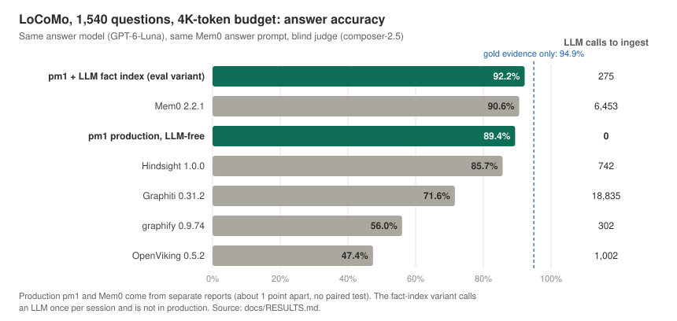

# pm1 results

Headline numbers. Every row comes from an experiment in [EVALUATION.md](EVALUATION.md), which gives the method,
the pre-registered rule and the interval for each comparison. Two retrieval paths appear:

- **[prod]** `search_sessions`, the production tool that agents call (no LLM anywhere);
- **[eval]** `memory_recall`, the path most LoCoMo experiments used, with options production does not have.

Scores judged by different models are never subtracted from each other.

## LoCoMo

1,540 questions (categories 1–4). Every system's context is answered by GPT-6-Luna with Mem0's official answer
prompt and judged blind by composer-2.5.

| System | LLM calls to ingest the 10 conversations | 1K tokens | 4K tokens |
|---|---|---|---|
| pm1-v3 [eval]: + LLM fact index (eval variant only) | 275 (about 1/23 of Mem0) | 0.870 | **0.922** |
| pm1-v3-local [eval]: facts written by a local Qwen3.5-4B | one per session, local model only | 0.846 | 0.911 |
| **Mem0 2.2.1** | 6,453 | **0.892** | 0.906 |
| **pm1 production `search_sessions` [prod]** | **0** | 0.864 | **0.894** |
| pm1-v2 [eval]: no facts | 0 | 0.838 | 0.894 |
| **Hindsight 1.0.0** | 742 | 0.838 | 0.857 |
| grep agent (Claude Haiku 5.5 finds the evidence)\* | at query time, about 5.6 calls per question | 0.845 | 0.847 |
| pm1, first version [eval] (12-record cap) | 0 | 0.792 | 0.795 |
| MemoryOS\*\* | 10,159 | — | 0.810 (about 6.8K) |
| **Graphiti 0.31.2** | 18,835 | 0.699 | 0.716 |
| graphify 0.9.74 | 302 | 0.527 | 0.560 |
| OpenViking 0.5.2 | 1,002 | 0.455 | 0.474 |
| Upper bound: gold evidence only | — | 0.949 | |

\* Judged by Claude Haiku 5.5, about 1 point more lenient than composer-2.5 on a calibration sample.
\*\* Judged in a separate batch in which Mem0 scored 0.909 at 4K and pm1-v5 0.925.

How to read it:

- **LLM-free production pm1 vs. Mem0.** At 4K, production pm1 scores 89.4% and Mem0 90.6%: about 1 point below Mem0.
  At 1K the gap is about 2.8 points. The two numbers come from two separate reports, judged in different batches, so
  there is no paired test of this difference. Mem0 needed 6,453 LLM calls to ingest; pm1 needed none.
- **The fact-index variant** (one LLM call per session, 275 in all) reaches 92.2% at 4K, 1.6 points above Mem0
  (+1.6 [+0.3, +3.0], descriptive). It is an evaluation variant and is not in production.
- **Production vs. pm1-v2**, re-judged together: 4K −0.5 [−2.0, +1.0], 1K +0.9 [−0.8, +2.7]; not separable.
  **Production vs. pm1-v3**: 4K −2.8 [−4.4, −1.3]; the difference is the fact index.
- pm1 loses most at 1K on multi-hop questions (pm1-v2 0.734 vs. Mem0 0.890).
- The production row was measured before the default budget, the next-turn option and the session layout changed.
  A later run of the current production path, judged by GPT-6.1-Sol, scored 0.884 at 1K and 0.916 at 4K (not
  comparable with this table's judge).

### Does the reranker help? (LoCoMo, [prod], GPT-6.1-Sol judge)

| Budget | Rerank all 100 candidates (production) | Rerank first 16 | No rerank | Production − no rerank [95% CI] |
|---|---|---|---|---|
| 1K | **0.884** | 0.849 | 0.786 | **+9.8 [+8.0, +11.7]** |
| 4K | **0.916** | 0.882 | 0.878 | **+3.8 [+2.5, +5.2]** |

## Retrieval benchmarks

| Benchmark | Metric | pm1 | Comparison |
|---|---|---|---|
| **LongMemEval-S**, 470 questions | all gold sessions in the top 5 | **0.923** (production retrieval) | agentmemory BM25 0.847: **+7.7 [+5.1, +10.4]**; agentmemory local vectors 0.826; grep 0.721 |
| same, CPU only, no reranker (94-question sample) | same | 0.926 | production retrieval 0.936 and agentmemory BM25 0.872 on the same sample |
| **Coding trajectories**, 40 SWE-agent sessions, 85 paraphrased questions | hit@1 | **0.976** | claude-mem 0.859 (+11.8 [+5.9, +18.8]); agentmemory BM25 0.847 |
| same, CPU only, no reranker | hit@1 | 0.918 | |
| REALTALK, 728 questions | answer accuracy | production 0.839 (4K); v5 configuration [eval] 0.883 | — |

pm1's lead on LongMemEval-S comes from vectors and reranking: its keyword search alone ties agentmemory's BM25
(−1.3 [−3.8, +1.1]).

## BEAM-1M (long conversations)

Dev split, 400 questions, Claude Haiku 5.5 answers, GPT-6.1-Sol judge. Mem0's row uses its own published answers
(GPT-5, its own answer prompt), re-judged by the same judge.

| Arm | Score | Mem0 − arm [95% CI] |
|---|---|---|
| Mem0 | **0.645** | |
| pm1 production 6K, BEAM's official short answer prompt | 0.535 | **+11.0 [+7.0, +14.9]** |
| pm1 production 6K, Mem0's answering rules | 0.639 | |
| pm1 production 6K, Mem0's answering rules, + event rows from a local 27B model (not in production) | 0.662 | −1.8 [−5.5, +1.9]: lead not shown |

On BEAM-1M with its official prompt, pm1 is about 11 points behind Mem0. Most of that gap is the answer step: with
the same retrieved context, Mem0's answering rules move pm1 from 0.551 to 0.639 (same 400 questions, fresh answers).
Mem0 leads on preferences, summaries, multi-session questions, instructions and event order; pm1 leads on
contradictions (0.655 vs. 0.241), abstention and knowledge updates.

## Cost

**Ingest** (LoCoMo, 10 conversations, 272 sessions; all LLM calls to the same model through one proxy):

| System | LLM calls | Input tokens | Ingest time (sum of units) |
|---|---|---|---|
| **pm1 production / v2** | **0** | 0 | 0.3 h (vectors only) |
| pm1-v3 (fact index) | 275 | 0.28M (0.73M with the per-call overhead; Mem0: 59.4M with overhead) | — |
| graphify | 302 | 0.7M | 0.4 h |
| Hindsight | 742 | 4.9M | 0.8 h |
| OpenViking | 1,002 | 6.4M | — |
| Mem0 | 6,453 | 49.8M | 14.4 h |
| Graphiti | 18,835 | 38.1M | 21.5 h |

Input tokens exclude a fixed overhead of about 1,635 tokens per call added by the proxy, except where noted.

**Tokens per correct answer** (ingest + retrieval + answering, spread over the 1,540 questions; real use spreads the
ingest cost over many more questions, which lowers the numbers for Mem0 and Graphiti):

| System | 1K | 4K |
|---|---|---|
| pm1, first version (measured) | 4,914 | 4,961 |
| pm1-v2 (measured) | 4,877 | 7,401 |
| pm1 production (estimate) | | about 7,000 |
| Hindsight (measured) | 10,270 | 13,588 |
| Mem0 (measured) | 48,942 | 50,406 |
| Graphiti (measured) | 70,450 | 70,962 |

## Latency

| Setting | p50 | p95 |
|---|---|---|
| **production `search_sessions`, real calls over one week (291 calls)** | **3.7 s** | 7.0 s |
| CPU path, keyword + vector fusion, about 745 spans, two threads | 6 ms | 8 ms |
| LoCoMo [eval] path (one small store per conversation) | 150 ms | 431 ms |
| Mem0 retrieval on LoCoMo | 131 ms | 205 ms |
| Hindsight retrieval on LoCoMo | 8.4 s | 13.6 s |

Almost all production latency is the reranker (Qwen3-Reranker-0.6B on vLLM, 100 candidates, waits up to 8 s).
